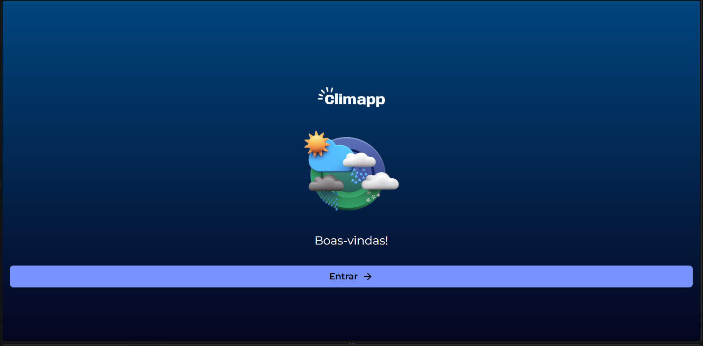
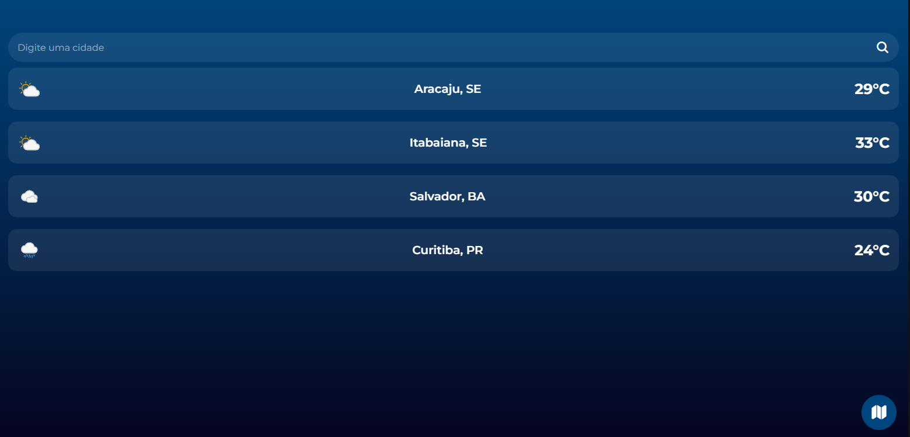
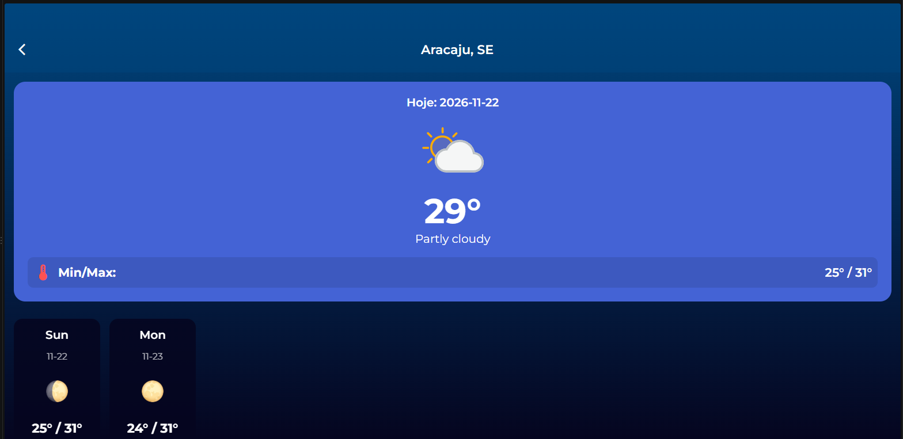

# Climapp

<p align="center">
  <strong>Clima das suas cidades favoritas, em um só lugar.</strong><br />
  Aplicativo de previsão do tempo desenvolvido com React Native, Expo e TypeScript.
</p>

## Telas do aplicativo

<p align="center">
  
  
  
</p>

## Funcionalidades

- Lista de cidades com temperatura e condição atual.
- Pesquisa entre as cidades carregadas.
- Detalhes do clima atual e previsão diária.
- Localização do dispositivo e mapa interativo no Android e iOS.
- Estados de carregamento, erro e opção para tentar novamente.
- Tela informativa no navegador para a função de mapa, que depende de recursos nativos.

## Tecnologias

- Expo SDK 54 e React Native 0.81
- TypeScript e Expo Router
- Expo Location e React Native Maps
- API de previsão do tempo HG Brasil

## Requisitos

- Node.js LTS e npm
- Expo Go em um dispositivo Android ou iOS, ou um emulador configurado

## Como executar

1. Clone o repositório e acesse a pasta do projeto.
2. Instale as dependências:

   ```bash
   npm install
   ```

3. Copie `.env.example` para `.env` e configure sua chave da API (veja [Configuração da API](#configuração-da-api)).
4. Inicie o Expo:

   ```bash
   npx expo start
   ```

5. Escaneie o QR code com o Expo Go ou pressione `a` no terminal para abrir o emulador Android.

Para executar no navegador, use `npx expo start --web`. O mapa interativo e o rastreamento de localização estão disponíveis no Android e iOS. No navegador, a tela do mapa informa essa limitação e oferece um link para o OpenStreetMap.

## Configuração da API

O app usa a API de previsão do tempo HG Brasil. Configure estas variáveis no arquivo `.env`:

```dotenv
EXPO_PUBLIC_API_URL=https://api.hgbrasil.com/weather
EXPO_PUBLIC_API_KEY=sua_chave_aqui
EXPO_PUBLIC_IMAGE_URL=https://assets.hgbrasil.com/weather/icons/conditions/
EXPO_PUBLIC_MOON_PHASE_URL=https://assets.hgbrasil.com/weather/icons/moon/
```

Preencha `EXPO_PUBLIC_API_KEY` com uma chave válida. A chamada web usa o formato `json-cors`; para publicar o site, autorize o domínio da aplicação no painel do provedor.

Variáveis com prefixo `EXPO_PUBLIC_` ficam acessíveis no aplicativo. Use somente valores que possam ser públicos e, em produção, proteja a chave da API por meio de um serviço intermediário. Após alterar o `.env`, reinicie o Expo.

## Verificação de tipos

```bash
npx tsc --noEmit
```

## Estrutura do projeto

```text
app/                 Rotas e telas do aplicativo
  screens/           Lista de cidades, previsão e mapa
components/          Componentes reutilizáveis
constants/           Tema e valores compartilhados
docs/screenshots/    Capturas de tela para este README
hooks/               Hooks de interface
interfaces/          Tipos TypeScript
mocks/               Dados de exemplo
assets/              Imagens e ícones
```

## Observações

- A lista inicial contém Aracaju, Itabaiana, Salvador e Curitiba.
- A pesquisa filtra cidades já carregadas; não consulta novas cidades na API.
- A localização exige permissão do usuário e, no navegador, permissões e conexão segura.
- O marcador de referência do mapa aponta para Arcos da Orla, em Aracaju.

